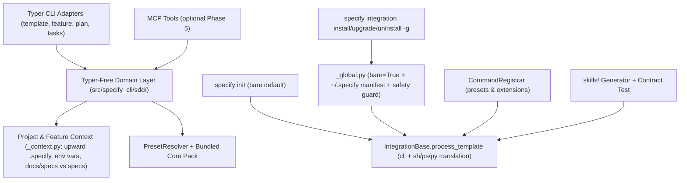

# Implementation Plan: Drop-In Parity, Bare-Mode Completeness & Documentation Alignment

**Branch**: `docs/drop-in-parity-spec` | **Date**: 2026-11-04 | **Spec**: [spec.md](./spec.md)

**Input**: Feature specification from [`docs/specs/001-drop-in-parity/spec.md`](./spec.md)

---

## Summary

Bring the `juftin/spec-kit` fork to complete, bug-free drop-in parity with `github/spec-kit` while preserving PR #1's guiding constraint (**minimal diff footprint on upstream files for clean upstream merges**). Specifically:

1. **Fix CI blockers & critical bugs** (`ruff` unused imports, `markdownlint-cli2` list spacing, broken `specify integration install --global`, `specify tasks setup` behavioral divergence, and `specify self upgrade` pointing to upstream).
2. **Extract a Typer-free SDD domain layer** (`src/specify_cli/sdd/`) achieving 1:1 behavioral parity with `scripts/python/{common,create_new_feature,check_prerequisites,setup_plan,setup_tasks,resolve_template}.py` (upward `.specify/` discovery, `SPECIFY_FEATURE_DIRECTORY` / `SPECIFY_FEATURE_NO_PERSIST` / `SPECIFY_FEATURE`, timestamp numbering, Unicode slugs, 244-byte truncation, `spec.md` collision guards, and clean `PresetError` handling).
3. **Complete bare-mode ecosystem support** across `CommandRegistrar` (presets/extensions), non-skills `IntegrationBase` subclasses, `ps` script translation, bundled `speckit` workflows, and `docs/specs/` fallbacks in bundled presets/extensions.
4. **Eliminate drift in `skills/` & align docs** via a deterministic `skills/` generator + pytest contract gate and reconciled documentation.
5. **(Optional Phase 5) Expose SDD operations via MCP** (`specify mcp`) and mirror tests under `tests/specify_cli/`.

---

## Technical Context

**Language/Version**: Python 3.11+ (CI matrix: Python 3.11, 3.12, 3.13 on Ubuntu + Windows)

**Primary Dependencies**: Existing runtime dependencies only (`typer`, `click`, `rich`, `pyyaml`, `packaging`, `platformdirs`, `pathspec`, `json5`, `readchar`) — **zero new runtime dependencies**

**Storage**: Local filesystem (`.specify/*.json` metadata, `docs/specs/` or legacy `specs/`, `~/.specify/integrations/*.manifest.json` for `--global`)

**Testing**: `.venv/bin/python -m pytest -n 0` (per [`AGENTS.md`](../../../AGENTS.md)), `uvx ruff@0.15.0 check src tests`, `npx markdownlint-cli2`

**Target Platform**: Linux, macOS, Windows (including Windows PowerShell 5.1 compatibility per [`AGENTS.md`](../../../AGENTS.md) and `cp1252` console safety)

**Project Type**: Developer CLI + Agent Skills Catalog + Local stdio MCP Server

**Performance Goals**: Instantaneous CLI startup (lazy imports preserved) and sub-50ms in-memory template/workflow resolution

**Constraints**: Offline-first execution; SHA-256 manifest tracking & path-traversal confinement; minimal edits to existing upstream files so `git merge upstream/main` remains low-conflict

**Scale/Scope**: ~8 fork/new modules, ~10 surgical hooks across existing upstream modules, 11 pre-rendered `skills/` files, and 6 documentation pages

---

## Constitution Check

*GATE: Evaluated against Spec Kit Constitution Principles I–V (`.specify/memory/constitution.md`) and [`AGENTS.md`](../../../AGENTS.md).*

| Principle | Gate Status | How This Plan Complies |
|---|---|---|
| **I. Code Quality & Architectural Discipline** | PASS | Extracts all SDD business logic out of Typer handlers into Typer-free `src/specify_cli/sdd/` modules (`_context.py`, `_operations.py`, `_skills_catalog.py`); uses `from __future__ import annotations` and modern typing throughout. |
| **II. Test-Backed Change (NON-NEGOTIABLE)** | PASS | Every bug fix includes before/after regression tests; adds parity tests against `scripts/python/*.py`, global manifest round-trip tests, bare-mode preset/extension/workflow tests, and a `skills/` sync contract test. Network calls (`_version.py`) remain 100% mocked. |
| **III. CLI & UX Consistency** | PASS | Preserves `--json` stdout purity (errors as JSON/Rich to stderr + exit `1`), Rich error styling, and adds symmetric `--global` (`-g`) across `integration install`, `uninstall`, and `upgrade`. Updates [`docs/reference/core.md`](../../reference/core.md) and [`docs/integrations/cli.md`](../../integrations/cli.md). |
| **IV. Offline-First & Idempotent File Ops** | PASS | Bundled templates and `speckit` workflow resolve 100% offline from wheel assets; `--global` installs persist `~/.specify/integrations/<key>.manifest.json` with SHA-256 hashes and refuse to clobber modified files unless `--force` is passed. |
| **V. Minimal Dependencies & Path Safety** | PASS | Zero new dependencies; reuses [`_project.py`](../../../src/specify_cli/_project.py) (`preflight_project_policy`) for symlink/containment safety and guards `$HOME` writes during `--global` install. |

> [!IMPORTANT]
> **Upstream Merge Footprint Strategy**: All new logic lives in dedicated fork-owned modules (`src/specify_cli/sdd/`, `src/specify_cli/integrations/_global.py`), while edits to upstream files (`_version.py`, `agents.py`, `integrations/base.py`, `integrations/command_*.py`, `workflows/`) are kept to 2–15 line delegated hooks.

---

## Architecture Overview



---

## Project Structure

### Documentation (this feature)

```text
docs/specs/001-drop-in-parity/
├── spec.md              # Feature specification (prioritized stories, FRs, SCs)
└── plan.md              # This implementation plan
```

### Source Code (repository root)

```text
src/specify_cli/
├── sdd/                                  # [NEW] Shared Typer-free SDD domain & skills generator
│   ├── __init__.py                       # Public exports & CLI registration entrypoint
│   ├── _context.py                       # Upward .specify walk, SPECIFY_INIT_DIR, SPECIFY_FEATURE_*, specs base
│   ├── _operations.py                    # template_resolve, feature_init/current/check, plan_setup, tasks_setup
│   └── _skills_catalog.py                # Deterministic generator for top-level skills/speckit*/SKILL.md
├── command_template.py                   # [MOD] Thin Typer adapter delegating to sdd._operations
├── command_feature.py                    # [MOD] Thin Typer adapter + full create_new_feature flags, fix F401
├── command_sdd.py                        # [MOD] Thin Typer adapter fixing tasks_setup & plan_setup, fix F401
├── _version.py                           # [MOD] Fork-aware GITHUB_API_LATEST & _GITHUB_SOURCE_URL + env override
├── agents.py                             # [MOD] Bare-mode / scripts.cli support in CommandRegistrar
├── integrations/
│   ├── _global.py                        # [NEW] Global install/uninstall/upgrade helper & home-safety guard
│   ├── base.py                           # [MOD] Forward bare= across subclasses; add check-prerequisites.ps1
│   ├── copilot/__init__.py               # [MOD] Forward bare= in _setup_commands
│   ├── command_install.py                # [MOD] Delegate --global to _global.py (bare=True + manifest.save())
│   ├── command_uninstall.py              # [MOD] Add --global / -g support via _global.py
│   └── command_upgrade.py                # [MOD] Add --global / -g support via _global.py
└── workflows/
    ├── engine.py                         # [MOD] Fallback to bundled workflows/speckit when absent on disk
    └── _operation_list.py                # [MOD] Include bundled workflows in bare projects

presets/ & extensions/
├── presets/constitution-sync/commands/speckit.constitution.md  # [MOD] Bare-safe template check note
├── extensions/agent-context/scripts/{bash,powershell,python}/  # [MOD] Scan docs/specs/ + specs/
└── extensions/git/                       # [MOD] Support docs/specs/ & bare SPECIFY_INIT_DIR

skills/
└── speckit*/SKILL.md                     # [MOD] Regenerated deterministically & markdownlint-clean

docs/ & Root Markdown
├── README.md                             # [MOD] Fix MD032, clarify bare vs global, fix issue/docs links
├── docs/installation.md                  # [MOD] Fix MD032, remove upstream/PyPI contradictions, fix --script note
├── docs/reference/core.md                # [MOD] Document --bare/--scaffold, template, feature, plan, tasks
├── docs/integrations/cli.md              # [MOD] Document --global (-g) for install/uninstall/upgrade
├── docs/quickstart.md                    # [MOD] Align install & docs/specs/ paths
└── docs/upgrade.md                       # [MOD] Document git-based fork upgrade & --global skill refresh

tests/
├── contract/test_skills_catalog_sync.py  # [NEW] Enforces skills/ == generator output
├── specify_cli/sdd/                      # [NEW] Mirrored unit + script-parity tests for sdd operations
└── integrations/test_global_install.py   # [MOD] Verify CLI content, manifest, uninstall/upgrade, unsafe-agent guard
```

**Structure Decision**: Consolidate all new zero-clone SDD operations into `src/specify_cli/sdd/` and global integration lifecycle helpers into `src/specify_cli/integrations/_global.py`, keeping existing `command_*.py` entrypoints thin and minimizing diff lines in upstream modules.

---

## Phased Execution Plan

### Phase 1 (P0): CI Green & Critical Correctness Fixes

1. **Fix Ruff & Markdownlint CI failures**
   - Remove unused imports in [`src/specify_cli/command_feature.py`](../../../src/specify_cli/command_feature.py) and [`src/specify_cli/command_sdd.py`](../../../src/specify_cli/command_sdd.py).
   - Add blank lines before lists in [`README.md`](../../../README.md) and [`docs/installation.md`](../../installation.md).
2. **Fix `specify tasks setup` semantic bug** ([`src/specify_cli/command_sdd.py`](../../../src/specify_cli/command_sdd.py))
   - Require both `plan.md` and `spec.md` to exist (matching [`scripts/python/setup_tasks.py`](../../../scripts/python/setup_tasks.py)).
   - Stop writing raw unfilled `tasks-template` to `tasks.md` on disk (`tasks.md` is generated by the agent from `TASKS_TEMPLATE_CONTENT`).
   - Set `"TASKS_TEMPLATE"` to the resolved template path/source identifier rather than `str(tasks_file)`.
   - In `plan_setup`, reject empty `plan-template` content and align plain-text output keys with [`scripts/python/setup_plan.py`](../../../scripts/python/setup_plan.py).
3. **Fix `specify integration install/uninstall/upgrade --global`**
   - Create `src/specify_cli/integrations/_global.py` encapsulating global root (`Path.home()`), safety validation (allow skills-mode integrations whose writes stay inside `<agent_folder>/skills` or dedicated user agent config; reject workspace-polluting modes like `copilot --commands` or `generic` without explicit path), `bare=True` template rendering, and `manifest.save()` to `~/.specify/integrations/<key>.manifest.json`.
   - Wire `--global` / `-g` into [`command_install.py`](../../../src/specify_cli/integrations/command_install.py), [`command_uninstall.py`](../../../src/specify_cli/integrations/command_uninstall.py), and [`command_upgrade.py`](../../../src/specify_cli/integrations/command_upgrade.py).
4. **Make `specify self check` & `specify self upgrade` fork-safe** ([`src/specify_cli/_version.py`](../../../src/specify_cli/_version.py))
   - Point default repo slug to `juftin/spec-kit` (overridable via `SPECIFY_UPGRADE_REPO`) for both `GITHUB_API_LATEST` and `_GITHUB_SOURCE_URL`, and ensure upgrade guidance uses `git+https://github.com/<repo>.git` rather than bare PyPI `specify-cli` when installed from Git.

---

### Phase 2 (P1): Full SDD Script Parity & Shared Domain Layer

1. **Create `src/specify_cli/sdd/_context.py` and `_operations.py`**
   - **Project root resolution**: Check `SPECIFY_INIT_DIR` via `_resolve_init_dir_override_unrendered()` in [`_project.py`](../../../src/specify_cli/_project.py); otherwise walk upward from `Path.cwd()` for `.specify/` (matching `find_specify_root()` in [`scripts/python/common.py`](../../../scripts/python/common.py)) and validate with `preflight_project_policy()`. Allow `specify template` and `specify feature init` to fall back to `Path.cwd()` when run in an uninitialized repo (e.g., `npx skills` zero-init flow), while `feature check`, `plan setup`, and `tasks setup` require either `SPECIFY_FEATURE_DIRECTORY` or an existing `.specify/`.
   - **Environment variable parity**: Honor `SPECIFY_FEATURE_DIRECTORY` (resolving relative to `project_root` with path-containment check), `SPECIFY_FEATURE_NO_PERSIST` (`1`/`true` skips writing `.specify/feature.json`), and `SPECIFY_FEATURE` (`BRANCH` override).
   - **Feature creation parity**: Port timestamp numbering (`feature_numbering == "timestamp"` in `.specify/init-options.json` or `--timestamp`), `--number`, `--short-name`, `--dry-run`, `--allow-existing-branch`, Unicode-preserving slug normalization (`\w` letters/digits rather than ASCII-only `[a-z0-9]`), 244-byte UTF-8 name fitting, and non-destructive `spec.md` collision checks from [`scripts/python/create_new_feature.py`](../../../scripts/python/create_new_feature.py).
   - **Clean error & Windows encoding handling**: Catch `PresetError`, `ProjectResolutionError`, and `OSError` cleanly; emit `{"error": ...}` to stderr when `--json` is passed and `ensure_ascii=True` where Windows stdout encoding is non-UTF-8.

---

### Phase 3 (P1): Bare-Mode Ecosystem Compatibility

1. **Fix `CommandRegistrar` for presets & extensions in bare mode** ([`src/specify_cli/agents.py`](../../../src/specify_cli/agents.py))
   - Extract the bare script-to-CLI resolver on `IntegrationBase` into a reusable helper `IntegrationBase.resolve_bare_script_command(script_commands)` (supporting `.sh`, `.ps1`, and `.py` variants of `resolve-template`, `setup-plan`, `setup-tasks`, and `check-prerequisites`, translating PowerShell flags `-Json`, `-RequireSpec`, `-RequireTasks`, `-IncludeTasks`, `-PathsOnly`, `-Template <name>` to POSIX CLI flags).
   - Call that helper inside `CommandRegistrar.resolve_skill_placeholders()` and Markdown/TOML/YAML command registration whenever `init_opts.get("footprint") == "bare"`.
2. **Forward `bare` across all `IntegrationBase` subclasses**
   - Pass `bare=opts.get("bare", False)` in `MarkdownIntegration.setup`, `TomlIntegration.setup`, `YamlIntegration.setup` ([`src/specify_cli/integrations/base.py`](../../../src/specify_cli/integrations/base.py)), and `CopilotIntegration._setup_commands` ([`src/specify_cli/integrations/copilot/__init__.py`](../../../src/specify_cli/integrations/copilot/__init__.py)).
3. **In-memory bundled `speckit` workflow fallback in bare mode**
   - In `WorkflowEngine.load_workflow` ([`src/specify_cli/workflows/engine.py`](../../../src/specify_cli/workflows/engine.py)) and workflow listing/status helpers ([`src/specify_cli/workflows/_operation_list.py`](../../../src/specify_cli/workflows/_operation_list.py), `_commands.py`), fall back to packaged `workflows/<id>/workflow.yml` when the workflow is not overridden or explicitly disabled in `.specify/workflows/`, making `specify workflow list` and `specify workflow run speckit` work out of the box in bare projects.
4. **Bundled preset & extension `docs/specs/` + bare support**
   - Update [`presets/constitution-sync/commands/speckit.constitution.md`](../../../presets/constitution-sync/commands/speckit.constitution.md) to treat missing `.specify/templates/*.md` as expected in bare mode.
   - Update [`extensions/agent-context/scripts/python/update_agent_context.py`](../../../extensions/agent-context/scripts/python/update_agent_context.py) (`.sh`, `.ps1`, `.py` in lockstep, preserving PowerShell 5.1 syntax) and [`extensions/git/commands/speckit.git.validate.md`](../../../extensions/git/commands/speckit.git.validate.md) fallback scans to check both `docs/specs/` and `specs/`, plus add `SPECIFY_INIT_DIR` resolution in `git-common.sh` / `git-common.ps1` without requiring `.specify/scripts/`.

---

### Phase 4 (P1/P2): Drift-Free `skills/` Catalog & Documentation Alignment

1. **Unify `skills/` generation & enforce via contract test**
   - Implement `src/specify_cli/sdd/_skills_catalog.py` (runnable via `python -m specify_cli.sdd._skills_catalog --write` or `--check`) that renders `skills/speckit-*/SKILL.md` directly through `IntegrationBase.process_template(..., bare=True)` + normalized frontmatter and CLI fallback note, and validates `skills/speckit/SKILL.md`.
   - Fix markdownlint issues in generated `skills/**/*.md` (including removing trailing spaces inside inline code spans).
   - Add `tests/contract/test_skills_catalog_sync.py` so any edit to `templates/commands/*.md` immediately flags stale `skills/` in CI.
2. **Reconcile documentation**
   - **[`README.md`](../../../README.md)**: Clarify bare project init (`.specify/*.json` metadata + agent skills, zero helper scripts/templates) vs global zero-repo-config (`npx skills add juftin/spec-kit -g` / `specify integration install -g`); fix issue link and docs references.
   - **[`docs/installation.md`](../../installation.md)**: Make `juftin/spec-kit` Git + `npx skills` the primary install routes, explicitly note that PyPI `specify-cli` points to upstream `github/spec-kit`, and fix the `--script` interactive prompt section to reflect bare default behavior.
   - **[`docs/reference/core.md`](../../reference/core.md)** & **[`docs/integrations/cli.md`](../../integrations/cli.md)**: Add full flag/JSON reference for `specify init --bare/--scaffold`, `specify template`, `specify feature init|current|check`, `specify plan setup`, `specify tasks setup`, and `specify integration install|upgrade|uninstall --global`.
   - **[`docs/quickstart.md`](../../quickstart.md)** & **[`docs/upgrade.md`](../../upgrade.md)**: Update paths (`docs/specs/`) and fork upgrade commands.

---

### Phase 5 (P2 — Optional): MCP Tool Exposure

1. Expose read-only (`specify_template`, `specify_feature_current`, `specify_feature_check`) and mutating (`specify_feature_init`, `specify_plan_setup`, `specify_tasks_setup`) tools in [`src/specify_cli/mcp_server/catalog.py`](../../../src/specify_cli/mcp_server/catalog.py) backed directly by `sdd._operations`, with contract tests in `tests/specify_cli/mcp_server/`.

---

## Verification & Validation Plan

All deterministic tests MUST run inside the worktree's virtualenv (`.venv/bin/python -m pytest -n 0`) per [`AGENTS.md`](../../../AGENTS.md):

1. **Lint & Formatting Gates**:
   - `uvx ruff@0.15.0 check src tests` -> must exit `0`
   - `npx --yes markdownlint-cli2 "README.md" "docs/**/*.md" "skills/**/*.md"` -> must exit `0`
2. **New & Updated Automated Suites (Positive + Negative + Regression Coverage)**:
   - `tests/specify_cli/sdd/test_operations_parity.py`: Side-by-side comparison of `sdd._operations` vs `scripts/python/*.py` across root/subdirectory cwd, `SPECIFY_FEATURE_DIRECTORY`, `SPECIFY_FEATURE_NO_PERSIST`, `SPECIFY_FEATURE`, `timestamp` vs `sequential`, Unicode names, 244-byte truncation, `spec.md` collision errors, and `tasks setup` non-creation of `tasks.md`.
   - `tests/integrations/test_global_install.py`: Asserts generated global `SKILL.md` uses `specify ...` CLI commands (no `.specify/scripts/`), verifies `~/.specify/integrations/<agent>.manifest.json` creation, tests `upgrade --global` and `uninstall --global` (preserving modified files without `--force`), and asserts rejection of home-unsafe integration modes.
   - `tests/test_init_bare.py`: Adds bare-mode tests for `specify preset add`, `specify extension add`, non-skills integrations (`Markdown`/`TOML`/`YAML`), PowerShell `.ps1`-only template translation, and `specify workflow list` / `specify workflow info speckit`.
   - `tests/specify_cli/selfs/`: Stubbed HTTP tests confirming `specify self check` and `specify self upgrade` target `juftin/spec-kit` and honor `SPECIFY_UPGRADE_REPO`.
   - `tests/contract/test_skills_catalog_sync.py`: Confirms `skills/` matches `_skills_catalog.py` output byte-for-byte.
3. **PowerShell 5.1 Parity Check**:
   - Validate any modified `.ps1` extension scripts (`update-agent-context.ps1`, `git-common.ps1`) use strictly Windows PowerShell 5.1-compatible syntax and pass existing parity tests (`tests/extensions/`).

---

## Complexity Tracking

| Deviation | Why Needed | Simpler Alternative Rejected Because |
|---|---|---|
| Retain `command_template.py`, `command_feature.py`, `command_sdd.py` as thin CLI shims calling `src/specify_cli/sdd/` instead of restructuring into multi-package `features/`, `plans/`, `tasks/` trees | Keeps `src/specify_cli/__init__.py` diff to the existing 3 `register()` lines from PR #1 while still satisfying Constitution Principle I (Typer-free `sdd/_operations.py` layer) | Creating 3 separate top-level subpackages + mirrored subtrees adds ~20 boilerplate files without reducing upstream merge conflicts |
